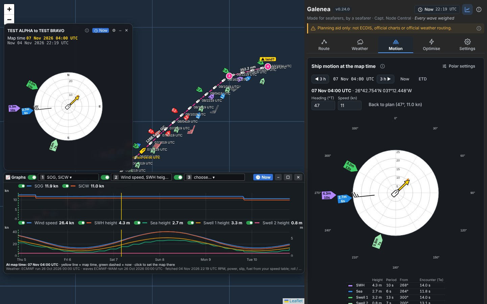

# Galenea – Made for seafarers, by a seafarer

A free plugin for [Windy.com](https://www.windy.com) for ship's officers. *Every wave weighed*: heavy weather and ship
motion first, fuel second.

**What it does**
- Loads a route from ECDIS files (RTZ, Transas RT3, BVS, GPX, Excel, CSV) and shows Windy's ECMWF / ECMWF-WAM forecast
  along it, checked against the ship's own weather limits (SWH, sea, swell 1, swell 2, wind).
- Roll and pitch estimates for the ship, and the IMO MSC.1/Circ.1228 warnings (parametric and synchronous rolling,
  surf-riding / broaching, successive high waves) in a polar diagram.
- A safe speed plan (slow down, speed up or wait for the weather to pass) and fuel-saving route optimisation.
- Distances (great circle, rhumb line, along the sea lanes), ports and canals; optional OpenSeaMap seamarks.
- Works in the browser and on phones.

> **Planning aid only.** It does not replace ECDIS, official charts, approved stability information or official
> weather routing. Forecasts can be wrong; "no warning" does not mean safe. The master decides.

**Install:** Windy menu (☰) → Install Windy Plugin (or find "Galenea" in Windy's plugin list once listed).

**Author:** Capt. Node Central. Feedback: the plugin's Help → Feedback.

**Licence:** MIT for the plugin's code; data from others keeps its own licence (see `THIRD-PARTY-NOTICES.md`).

**For developers:** Svelte 4 + TypeScript, built from Windy's plugin template. `npm install`, `npm test`,
`npm run build`. See `TECHNICAL-NOTES.md`.

This public copy is updated with each released version.
